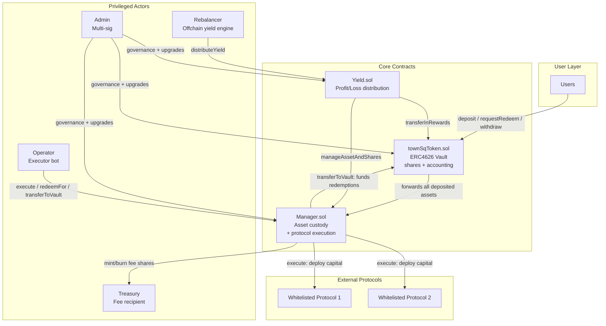
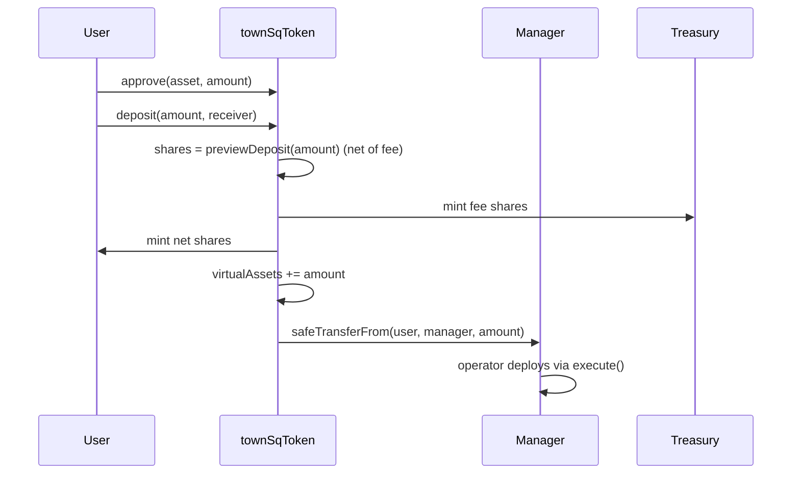
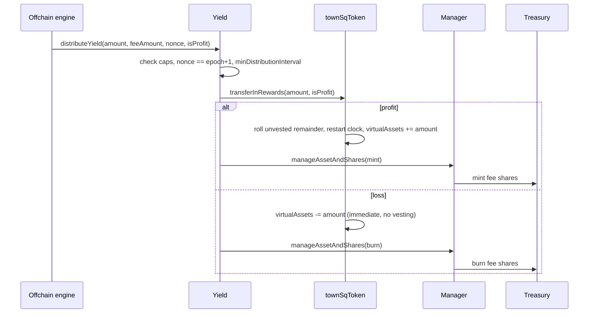

# townSqUSD — ERC4626 Yield Vault

A yield-bearing vault built on ERC4626, with offchain-driven yield distribution, linear
yield vesting, and a request-then-execute withdrawal flow with a cooldown.

Deployment targets: **Monad**, **Base**, **BNB Smart Chain**.

---

## Read This First

Four properties of this system are not what an ERC4626 reader would assume. Everything else
in this README makes more sense once these are clear.

**1. The vault holds no assets.** Deposits are forwarded to the `Manager`, which custodies
everything and deploys it to whitelisted protocols. `townSqToken.totalAssets()` is an
*accounting figure* (`virtualAssets - unvested`), not a token balance, and is never
reconciled against one.

**2. Redemptions must be funded before they can execute.** `_withdraw` transfers from the
vault's own balance and cannot pull from the `Manager`. A user whose cooldown has elapsed
still cannot redeem until assets are pushed into the vault — normally by the operator via
`Manager.transferToVault`. This is an offchain-triggered step, not an automatic one.

**3. Yield is trusted input.** The vault cannot see strategy balances. An offchain engine
calls `Yield.distributeYield(amount, feeAmount, nonce, isProfit)` and the vault books
whatever it is told, bounded only by percentage caps and a rate limit. `amount` and
`feeAmount` are two *separate* slices of realised P&L — `feeAmount` is **not** deducted from
`amount`.

**4. It is not a drop-in ERC4626.** `withdraw`/`redeem` require a prior `requestRedeem` and
revert otherwise; `maxWithdraw`/`maxRedeem` are not overridden and over-report; and
allowance-based withdrawal is disabled (`caller` must equal `owner`). Integrators that
assume standard semantics will break. See [`docs/KNOWN_ISSUES.md`](docs/KNOWN_ISSUES.md)
D-01/D-02.

---

## Architecture



All three core contracts are UUPS-upgradeable behind an ERC1967 proxy (`Proxy.sol`).

### Contracts

| File | Role |
| --- | --- |
| `src/townSqToken.sol` | ERC4626 vault. Shares, deposit fees, redemption requests + cooldown, yield vesting, `virtualAssets` accounting. |
| `src/Manager.sol` | Custodies all deposited assets. Executes batched calls to whitelisted protocols. Coordinates asset/share updates on behalf of `Yield`. |
| `src/Yield.sol` | Epoch-sequenced profit/loss distribution with rate limiting and percentage caps. |
| `src/Proxy.sol` | ERC1967 proxy wrapper (no added logic). |
| `src/Interface/ItownSqUSD.sol` | Vault interface. |
| `src/Interface/IManager.sol` | Manager interface + `ManageAssetAndShares` struct. |
| `src/Errors.sol` | 37 custom errors. |

### Roles

| Role | Capabilities |
| --- | --- |
| `DEFAULT_ADMIN_ROLE` | **Upgrade all three contracts**; grant/revoke roles. No timelock. |
| `ADMIN_ROLE` | All parameter setters, whitelist management, pause/unpause, `emergencyRecover`. |
| `OPERATOR_ROLE` | `Manager.execute` (arbitrary calls to whitelisted targets), `redeemFor`, `transferToVault`. |
| `REBALANCER_ROLE` | `Yield.distributeYield`. |

Contract-to-contract authorisation is separate: only `Manager` may call the vault's
`updateTotalAssets` / `mintVaultToken` / `burnVaultToken` / `redeemFor`, and only `Yield`
may call `transferInRewards` and `Manager.manageAssetAndShares`. Mint and burn are further
restricted to the treasury address.

> `OPERATOR_ROLE` makes arbitrary calls with arbitrary calldata from the address holding
> every deposited asset. The admin-managed whitelist is the only constraint on where funds
> can go. Treat it as a hot key with total-loss blast radius —
> [`docs/KNOWN_ISSUES.md`](docs/KNOWN_ISSUES.md) K-04.

---

## Parameters

| Parameter | Contract | Default | Bound |
| --- | --- | --- | --- |
| `cooldownPeriod` | vault | set at init | ≤ 7 days |
| `vestingPeriod` | vault | set at init | ≤ 30 days |
| `fee` (deposit fee) | vault | `0` | ≤ `1e18` (1%; `100e18` == 100%) |
| `maxYieldPercentage` | Yield | `50` (0.5%) | 1 … 10 000 bps of `totalAssets()` |
| `maxFeePercentage` | Yield | `5000` (50%) | 0 … 10 000 bps of `amount` |
| `minDistributionInterval` | Yield | `79200` (22 h) | > 0 |
| `minSharesInVaultToken` | Manager | unset | > 0 once set |
| `maxRedeemCap` | Manager | `0` | `0` == uncapped |

The underlying asset must have **≤ 18 decimals** — `_decimalsOffset()` computes
`18 - asset.decimals()` and reverts on underflow. USDC (6 decimals on most chains) is the
intended asset.

---

## User Flows

### Deposit



The deposit reverts unless `shares >= manager.minSharesInVaultToken(vault)`.

### Withdrawal — request, wait, fund, execute

```mermaid
sequenceDiagram
    participant User
    participant Vault as townSqToken
    participant Operator
    participant Manager

    User->>Vault: requestRedeem(shares)
    Vault->>Vault: burn shares immediately
    Vault->>Vault: assets = previewRedeem(shares)  ← LOCKED IN HERE
    Vault->>Vault: virtualAssets -= assets; totalRequestedAmount += assets
    Note over Vault: cooldownPeriod elapses
    Operator->>Manager: transferToVault(asset, amount)
    Manager->>Vault: assets arrive in the vault
    User->>Vault: withdraw(assets, receiver, owner)
    Vault->>User: safeTransfer(assets)
    Vault->>Vault: delete request; totalRequestedAmount -= assets
```

Three things to note:

- **Shares burn at request time**, not at execution.
- **The asset amount is fixed at request time.** A pending redeemer is fully insulated from
  a loss booked during their cooldown, and forgoes any profit — remaining holders absorb the
  difference.
- **`withdraw` requires `assets` to equal the recorded request exactly** (`redeem` likewise
  for `shares`); any other value reverts. `redeemFor` (Manager/operator only) skips the
  cooldown.

### Yield distribution



**Profit vests; loss lands immediately.** On profit, `amount` is recognised linearly over
`vestingPeriod` — `getUnvestedAmount()` is subtracted from `totalAssets()` and decays to
zero. A new distribution rolls any unvested remainder into a fresh schedule and restarts the
clock; it never runs two schedules in parallel.

`vestingPeriod` is **not a per-user lockup.** It smooths recognition vault-wide. A new
depositor's shares appreciate the very next second; what vesting prevents is capturing a
whole lump sum by depositing immediately before a distribution — and it only *smooths* that,
it does not eliminate it.

---

## Cross-Chain Yield Distribution

Each chain runs its own vault. Yield is pooled globally so users earn the same rate
regardless of which chain they deposited on.

1. **Collect** total deposits and realised yield from every vault.
2. **Sum** across chains: `totalDeposit`, `totalYield`.
3. **Compute a global rate:** `newExchangeRate = ((totalDeposit + totalYield) * SCALE) / totalDeposit`
4. **Per vault:** `vaultYield = (newExchangeRate * vaultDeposit) / SCALE - vaultDeposit`
5. **Distribute:** the rebalancer calls `distributeYield` on each chain with that vault's figure.

> ⚠️ **`SCALE` is per-vault, not a global `1e6`.** It must be `10 ** asset.decimals()` for
> *that vault's* asset. USDC is 6 decimals on Base and native Monad, but the widely used
> Binance-Peg USDC on BNB Chain is **18 decimals**. Hardcoding `1e6` everywhere silently
> misprices any non-6-decimal vault — the contracts read `decimals()` dynamically and keep
> working, so the error surfaces only as wrong yield. Normalise to a common precision before
> summing, then scale back per vault.

### Worked example (two 6-decimal vaults, `SCALE = 1e6`)

| Vault | Deposit | Yield | Distributed |
| --- | ---: | ---: | ---: |
| Monad | 500,000 | 10,000 | 8,125 |
| Base | 300,000 | 3,000 | 4,875 |
| **Total** | **800,000** | **13,000** | **13,000** |

`newExchangeRate = ((800,000 + 13,000) * 1e6) / 800,000 = 1,016,250`, so
`monadYield = (1,016,250 * 500,000) / 1e6 - 500,000 = 8,125`. Distributed totals match
realised yield exactly.

---

## Development

### Prerequisites

Foundry only — there is no JS/TS toolchain in this repo.

```bash
curl -L https://foundry.paradigm.xyz | bash && foundryup
```

### Setup

```bash
git clone --recurse-submodules <repository-url> && cd townSqUSD
forge build
```

If you cloned without `--recurse-submodules`: `git submodule update --init --recursive`.
Dependencies are pinned as submodules (OpenZeppelin 5.7.0, forge-std 1.16.2).

### Environment

Fork tests read RPC URLs from `[rpc_endpoints]` in `foundry.toml`, which resolves
`${*_RPC_URL}` from the environment. **Never hardcode an RPC URL or API key in a `.sol`
file.** Copy the template and fill it in:

```bash
cp .env.example .env
```

| Variable | Needed for |
| --- | --- |
| `MONAD_RPC_URL` | `forkTest` (all tests) and `testDeploymentMonad` |
| `MONAD_FORK_BLOCK` | Optional. Pins the fork block; `forkTest` defaults to `93757428`, `testDeploymentMonad` to chain head (not reproducible). |
| `BASE_RPC_URL`, `BSC_RPC_URL`, `ETH_RPC_URL` | Registered in `foundry.toml` but no test currently uses them. |

### Test

```bash
forge test                       # everything
forge test --no-match-path 'test/{forkTest,testCrossChain}.t.sol'   # skip fork tests
forge test --match-contract TotalAssetsUnderflowPoC -vv             # one suite
forge test --gas-report
```

Fork tests fail with `environment variable ... not found` until the matching `*_RPC_URL` is
set. The `POC-*.t.sol` suites are characterisation tests: they document what the protocol
actually does (loss handling, vesting semantics, redemption funding, accounting bounds)
rather than only asserting happy paths — read them alongside the source.

### Deploy

```bash
# Dry run (no broadcast)
forge script script/Deploy.s.sol --rpc-url $RPC_URL

# Broadcast + verify
forge script script/Deploy.s.sol --broadcast --verify \
  --etherscan-api-key $API_KEY --rpc-url $RPC_URL --private-key $DEPLOYER_PK
```

Deployment leaves the three contracts **partially wired**. Eight follow-up configuration
calls are required before the protocol is safe to use, and the vault/manager references are
cyclic with no onchain consistency check. Do not skip
[`docs/DEPLOYMENT.md`](docs/DEPLOYMENT.md).

---

## Documentation

| Document | Contents |
| --- | --- |
| [`docs/ARCHITECTURE.md`](docs/ARCHITECTURE.md) | Trust model, asset custody, access control, value flow |
| [`docs/INVARIANTS.md`](docs/INVARIANTS.md) | 23 protocol invariants with per-invariant test status |
| [`docs/KNOWN_ISSUES.md`](docs/KNOWN_ISSUES.md) | Accepted risks, design decisions, open questions |
| [`docs/DEPLOYMENT.md`](docs/DEPLOYMENT.md) | Deploy order, required configuration, per-chain checks |
| [`audit/scope.md`](audit/scope.md) | Audit scope, LOC, commit hash, compiler notes |
| [`audit/static-analysis.md`](audit/static-analysis.md) | Slither results and triage |

---

## API Reference

### Vault (`townSqToken`)

**Deposits** — `deposit(assets, receiver)`, `mint(shares, receiver)`,
`previewDeposit(assets)`, `previewMint(shares)`. Previews are fee-inclusive.

**Redemptions** — `requestRedeem(shares)`, `withdraw(assets, receiver, owner)`,
`redeem(shares, receiver, owner)`, `canExecuteRedeem(user)`, `getRedeemRequest(user)`,
`redeemFor(user)` *(Manager only, skips cooldown)*.

**Accounting** — `totalAssets()`, `virtualAssets()`, `exchangeRate()`,
`exchangeRateScaled()`, `getUnvestedAmount()`, `totalRequestedAmount()`.

**Privileged** — `transferInRewards(amount, profit)` *(Yield)*,
`updateTotalAssets(amount, add)` / `mintVaultToken(to, shares)` /
`burnVaultToken(from, shares)` *(Manager, treasury-only target)*, `setManager`,
`setCooldownPeriod`, `setVestingPeriod`, `setFee`, `pause`, `unpause`, `emergencyRecover`.

### Manager

`execute(targets, data)` *(operator)* · `transferToVault(token, amount)` *(operator)* ·
`redeemFor(vault, user)` *(operator)* · `manageAssetAndShares(to, order)` *(Yield)* ·
`setWhitelistedAddresses`, `setTreasury`, `setManagerAndYield`, `setMinSharesInVaultToken`,
`setMaxRedeemCap` *(admin)*.

### Yield

`distributeYield(amount, feeAmount, nonce, isProfit)` *(rebalancer)* · `getEpoch()`,
`getLastDistributionTime()`, `getTownSqToken()`, `getManager()` · `setManager`,
`setMinDistributionInterval`, `setMaxYieldPercentage`, `setMaxFeePercentage` *(admin)*.

---

## Integration Examples

```solidity
// Deposit
IERC20(asset).approve(address(vault), amount);
uint256 shares = vault.deposit(amount, receiver);

// Redeem: request, wait for cooldown, then execute with the EXACT recorded amounts
vault.requestRedeem(shares);                       // shares burn now
// ... cooldownPeriod passes, and the vault must be funded ...
(uint256 s, uint256 a,,) = vault.getRedeemRequest(user);
require(vault.canExecuteRedeem(user), "cooldown not finished");
vault.redeem(s, user, user);                       // or vault.withdraw(a, user, user)
```

```solidity
// Deploy capital to whitelisted protocols (operator)
address[] memory targets = new address[](1);
bytes[] memory data = new bytes[](1);
targets[0] = protocol;
data[0] = abi.encodeCall(IProtocol.deposit, (amount));
manager.execute(targets, data);
```

---

## Security

**Implemented controls** — role-based access control on every state-changing entry point;
`nonReentrant` on deposit, withdraw, and `emergencyRecover`; `SafeERC20` throughout;
custom errors; `_disableInitializers()` in every implementation constructor;
`_authorizeUpgrade` gated on `DEFAULT_ADMIN_ROLE`; a 50-slot storage gap per contract;
whitelist-constrained external calls; sequential-nonce and rate-limited yield distribution;
caps on fees and per-distribution yield.

**Unsupported token types** — fee-on-transfer, rebasing, and assets with more than 18
decimals. `_deposit` credits the requested amount rather than the delta received.

**Centralisation** — the admin roles can upgrade all three contracts with immediate effect
and no timelock; the operator can move custodied assets to any whitelisted target; the
rebalancer sets the share price. Users cannot withdraw while paused, and pending
redemptions are not protected from `emergencyRecover`.

Read [`docs/KNOWN_ISSUES.md`](docs/KNOWN_ISSUES.md) before integrating or deploying — it
lists five accepted risks, eight intentional design decisions, and twelve untriaged
observations, including one credential-rotation item.
