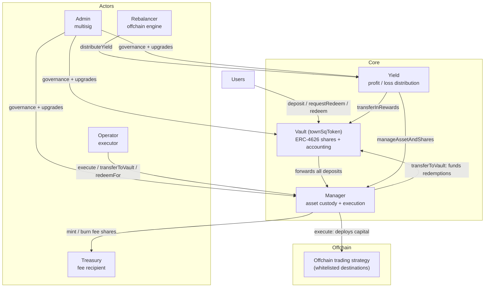

# Architecture

## Contract relationships

All three contracts are UUPS-upgradeable behind ERC-1967 proxies. The addresses you
interact with are the proxies, and they do not change when the implementation is upgraded.

## Who can do what

| Actor | Can | Cannot |
|---|---|---|
| **You** | Deposit, request redemption, collect your own redemption | Anything else |
| **Operator** | Deploy capital to whitelisted addresses, fund the vault, settle a user's request | Change the allowlist, report yield, change parameters |
| **Rebalancer** | Report each epoch's profit or loss | Move any asset |
| **Admin** (timelock, 48h) | Set the allowlist, fees, cooldown, caps; pause and unpause; emergency-recover assets | — |
| **Guardian** | Pause the vault, remove whitelist entries — instantly | Unpause, add to the allowlist, change parameters |
| **Governance (root admin)** (timelock, 48h) | Upgrade all contracts, grant and revoke every role | — |

Full enumeration in [Roles and permissions](../reference/roles.md).


The Admin role can both whitelist a destination and extract assets from the vault, and
both go through a **48-hour timelock** — delayed and public, but not prevented. Deposit
sizing should account for this. See
[Governance and the timelock](../operations/governance.md).


## Trust boundaries

There are two places where the protocol stops being enforced by code.

### 1. Capital leaving for the strategy

Once an operator calls `execute()` and assets move to a whitelisted destination, onchain
enforcement ends. Recovery depends on the offchain counterparty honouring its agreement.

**Enforced onchain:** deposits go only to the Manager; only whitelisted addresses can
receive capital; only Admin can change that list; every change and every batch emits an
event, so the destination set is publicly auditable.

**Not enforced onchain:** which addresses get whitelisted, how much leaves, when it comes
back, and whether any reserve is retained.

### 2. The reported yield

The share price is set entirely by the rebalancer's reports. Nothing onchain can check them
against the strategy's actual balances.

**Enforced onchain:** per-epoch magnitude caps, a minimum interval between epochs, strict
epoch sequencing, and duplicate rejection.

**Not enforced onchain:** whether the reported figure is true.

## What the vault guarantees

Properties that hold unconditionally, from the code:

- Shares can only be minted by depositing, or to the treasury as fees. No other mint path.
- Your redemption amount, once requested, cannot be changed by anyone.
- A redemption can only ever be paid to the request's owner.
- Only the Manager can mutate vault accounting, and only the Yield contract can instruct it.
- Every privileged action emits an event.

## What it explicitly does not guarantee


**"Users can always eventually withdraw" does not hold.** This is recorded as a known
limitation in the protocol's own invariant documentation. Withdrawal requires an operator
to fund the vault, and an admin pause blocks withdrawal entirely.


See [Risks and trust assumptions](../risks/README.md) for the complete list.
